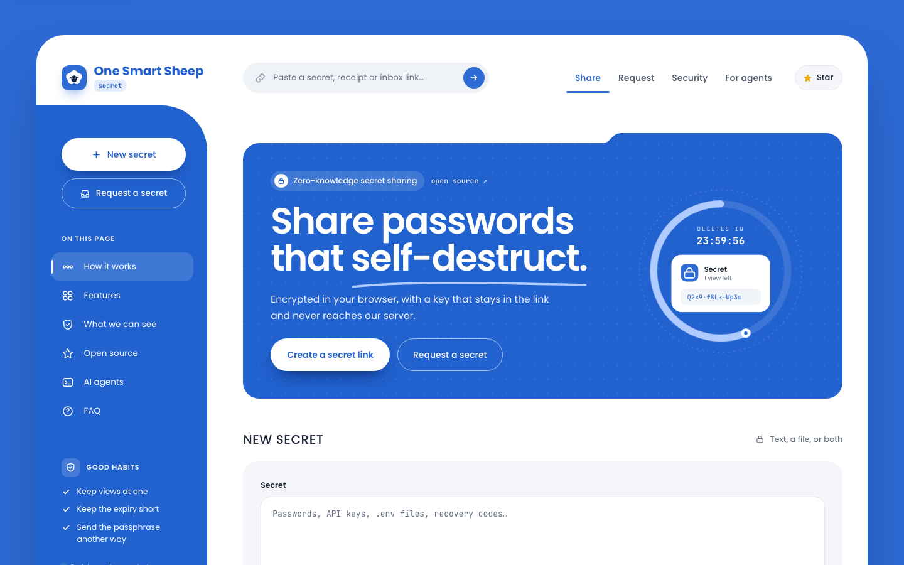
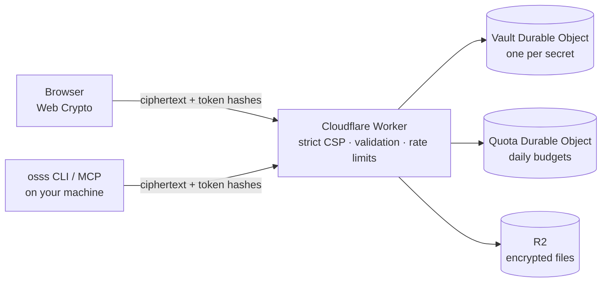

<p align="center">
  <picture>
    <source media="(prefers-color-scheme: dark)" srcset=".github/assets/banner-dark.svg">
    <source media="(prefers-color-scheme: light)" srcset=".github/assets/banner-light.svg">
    
  </picture>
</p>

<p align="center">
  <a href="https://secret.nafran.com"><strong>Live demo</strong></a>
  &nbsp;·&nbsp;
  <a href="docs/SECURITY.md"><strong>Security model</strong></a>
  &nbsp;·&nbsp;
  <a href="#-for-ai-agents"><strong>For AI agents</strong></a>
  &nbsp;·&nbsp;
  <a href="#-run-it-locally"><strong>Run it locally</strong></a>
</p>

<p align="center">
  <a href="https://github.com/aamirmursleen/keyburn.dev/actions/workflows/ci.yml"></a>
  
  
  
  
  
</p>

---

Passwords, API keys and `.env` files end up in chats, tickets and inboxes, where they stay forever.
**keyburn** sends them as a link that works once and then burns:

1. **Your browser encrypts it.** AES-256-GCM with the browser's own Web Crypto. Nothing readable leaves your device.
2. **You share the link.** The key is the part after `#`, which browsers never send to any server.
3. **It burns.** After its last view (1 to 10) or when its timer runs out (15 minutes to 7 days), it's deleted for good.

The server only ever stores encrypted data and hashes of one-time tokens. It never receives the key,
so it can't read what you share. And with the `osss` tool, **AI agents like Claude Code can use a
secret without ever seeing it.**

<p align="center">
  <picture>
    <source media="(prefers-color-scheme: dark)" srcset=".github/assets/screenshot-dark.png">
    
  </picture>
</p>

## ✦ Features

<table>
  <tr>
    <td width="50%" valign="top">
      <h3>🔐 Encrypted before it leaves you</h3>
      Text up to 64 KB and one file up to 25 MB, sealed with AES-256-GCM in your browser.
      Sizes are padded, so even the stored size gives little away.
    </td>
    <td width="50%" valign="top">
      <h3>🔥 Burns after reading</h3>
      One to ten views, fifteen minutes to seven days. Each secret lives in its own strongly
      consistent Durable Object, so a one-time link opens exactly once, even under a race.
    </td>
  </tr>
  <tr>
    <td valign="top">
      <h3>🗝️ A real second lock</h3>
      An optional passphrase is mixed into the key (PBKDF2-SHA256, 600,000 rounds) and never sent.
      Five wrong tries destroy the secret.
    </td>
    <td valign="top">
      <h3>🧾 A private receipt</h3>
      The sender sees when the secret was opened and from which country, and can burn it early.
    </td>
  </tr>
  <tr>
    <td valign="top">
      <h3>📥 Request a secret</h3>
      Send someone a request link. They answer once, encrypted to your key (ECDH P-256), and only
      your private inbox link can open it.
    </td>
    <td valign="top">
      <h3>🤖 Built for AI agents</h3>
      A CLI, an MCP server and a Claude Code hook let agents open links on your machine and use
      secrets without the value ever entering the conversation.
    </td>
  </tr>
  <tr>
    <td valign="top">
      <h3>🛡️ Nothing to track you with</h3>
      No accounts, cookies, analytics or third-party scripts. A Content Security Policy pinned to
      the app's own files, with Trusted Types, keeps injected code from running.
    </td>
    <td valign="top">
      <h3>⚡ On Cloudflare's edge</h3>
      One Worker, Durable Objects and R2. Zero runtime dependencies: every line of crypto is the
      platform's Web Crypto.
    </td>
  </tr>
</table>

## 🔎 How it works

```mermaid
sequenceDiagram
    autonumber
    participant S as Sender's browser
    participant K as keyburn (Cloudflare Worker)
    participant R as Recipient's browser
    S->>S: Make a random key S. Derive the id, tokens and AES-256-GCM keys (HKDF)
    S->>K: Ciphertext + SHA-256 hashes of the tokens (never S)
    K-->>S: Stored in the secret's own Durable Object
    S-->>R: https://…/s#S  (the part after # never leaves a browser)
    R->>K: Token derived from S
    K-->>R: Ciphertext. One view used; the last view deletes it
    R->>R: Decrypt locally
```

| The server stores | The server never sees |
| --- | --- |
| Ciphertext and its padded size | The key in the link, or the link itself |
| Creation, expiry and view times | Your text, files or file names |
| The country each view came from (for the receipt) | Your passphrase |
| SHA-256 hashes of one-time tokens | Request private keys |

The full protocol, threat model and limits are in **[docs/SECURITY.md](docs/SECURITY.md)**.

## 🤖 For AI agents

Paste a secret link into Claude Code, Codex or any MCP client, and the agent can **use** the secret
without **seeing** it. `osss` opens the link on your computer, keeps it encrypted in `~/.osss`, and
hands the agent a handle instead of the value:

```console
$ osss open https://secret.nafran.com/s#…
Opened. The secret is stored encrypted on this machine and was not shown.
Handle: osss_Lq3…_v9X…
Contains: 1 environment variable(s): CLOUDFLARE_API_TOKEN
The secret is now deleted from the server.

$ osss run osss_Lq3…_v9X… -- npx wrangler deploy
```

- **Handles, not values.** MCP results contain a handle and variable names only. The local copy is
  encrypted with a key that exists only inside the handle.
- **Use without seeing.** `osss run` passes the secret to one command as environment variables, and
  redacts it from the output. Names that could hijack a program (`PATH`, `NODE_OPTIONS`,
  `LD_PRELOAD`, proxies, certificate and endpoint overrides) are never exported.
- **Links kept out of the chat.** As a Claude Code `UserPromptSubmit` hook, `osss hook claude-code`
  catches a pasted link, opens it locally and stops the message before it reaches the model, then
  gives you the message back with a handle in place of the link.
- **Pinned and self-contained.** One zero-dependency file for Node.js 22+, pinned by SHA-256. It
  talks only to the keyburn servers, never follows redirects, refuses compressed responses and
  checks every reply.

Install it and connect Claude Code (the fingerprint is pinned by the build in `src/cli/release.json`):

```sh
(umask 077 && mkdir -p ~/.osss && cd ~/.osss && rm -f osss.download \
  && curl -fsSL -o osss.download https://secret.nafran.com/cli/osss-1.0.1.mjs \
  && echo "a70edb2257f680ec7a9265aa4f0f60532dad82267cabdefd38836c702ded7087  osss.download" | shasum -a 256 -c \
  && mv osss.download osss.mjs)
claude mcp add --scope user osss -- node ~/.osss/osss.mjs mcp
```

More, including Codex and the hook: **[/agents](https://secret.nafran.com/agents)**. Browser agents
get a WebMCP tool to create links, and crawlers and agents find the site through `llms.txt`, an
API catalog (RFC 9727), an OpenAPI description, an agent skill and Markdown versions of every
public page (`Accept: text/markdown`).

## 🏗️ Architecture



## 🛡️ Security engineering

- **Zero-knowledge protocol (`osss/v1`).** Keys derived with HKDF from a 256-bit link key; record ids
  bound to a token hash, so nobody can claim or probe an id; tokens stored only as hashes; unknown
  ids and wrong tokens look identical.
- **Hardened pages.** CSP pinned to exact files (no `'self'`), Trusted Types, COOP/COEP/CORP,
  `no-transform` so nothing upstream can inject scripts, no cookies and `no-referrer`.
- **Strict state.** One Durable Object per secret: atomic views, exact alarms, permanent burn markers,
  downloads cut off mid-stream when a secret is destroyed.
- **Abuse limits.** Per-IP rate limits, plus daily quotas per IP, per IPv6 /48 and globally.
- **Supply chain.** Zero runtime dependencies, exact version pins, `strict-allow-scripts`, Actions
  pinned by commit, and CLI releases pinned by SHA-256.
- **Reviewed.** An automated security audit and several AI-assisted code and security reviews, with
  every finding fixed. There has been no third-party audit yet.

## ✅ Quality

- Worker, Durable Object and crypto tests run in the real `workerd` runtime; the agent tool is tested
  in Node; coverage thresholds are enforced.
- Playwright end-to-end runs walk every flow (share, open, passphrase, files, receipts, requests,
  inbox, CLI, MCP, hook, WebMCP) and fail if a key, passphrase or plaintext is ever sent to the
  server.
- [CI](https://github.com/aamirmursleen/keyburn.dev/actions/workflows/ci.yml) runs it all on every push.

## 🚀 Run it locally

```bash
git clone https://github.com/aamirmursleen/keyburn.dev && cd keyburn.dev
npm install                       # Node.js 24.22+ (npm 11.19+)
echo "IP_HASH_SECRET=$(openssl rand -hex 32)" > .dev.vars
npm run dev                       # http://localhost:8787
npm test                          # workerd + Node test suites
npm run build && npm run e2e      # Playwright end to end
```

Deployment, configuration and limits: **[docs/DEPLOYMENT.md](docs/DEPLOYMENT.md)**.

## 🗂️ Project layout

```
src/
  shared/    protocol, crypto (AES-256-GCM, HKDF, PBKDF2, ECDH) and encoding, used everywhere
  worker/    the Cloudflare Worker: routing, headers, validation, Vault and Quota Durable Objects
  client/    the browser app (one bundle, no framework)
  cli/       osss: CLI, MCP server and Claude Code hook for AI agents
public/      pages, styles, fonts and the agent discovery files
test/        workerd and Node test suites
e2e/         Playwright end-to-end runs
docs/        SECURITY.md (design and limits), DEPLOYMENT.md
```

## 🧭 Roadmap

- Retry-safe opens, so a lost response can never burn a one-view secret
- Signed `osss` releases with an offline key
- EU-only storage option (Durable Object jurisdiction and an EU R2 bucket)

## 🔒 Reporting a vulnerability

Please use **[private vulnerability reporting](https://github.com/aamirmursleen/keyburn.dev/security/advisories/new)**,
not public issues. See [SECURITY.md](.github/SECURITY.md).

## License

No license has been chosen yet, so all rights are reserved for now: you can read and audit the code,
but not reuse it.

<p align="center"><sub>Designed and built for One Smart Sheep.</sub></p>
